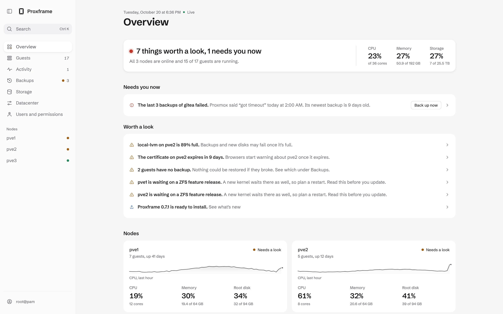

  <picture>
    <source media="(prefers-color-scheme: dark)" srcset="assets/brand/lockup-light.svg">
    
  </picture>

A second web interface for Proxmox VE and Backup Server.

  <a href="https://proxframe.app">Website</a> ·
  <a href="https://proxframe.app/product.html#demo">Demo</a> ·
  <a href="ROADMAP.md">Roadmap</a> ·
  <a href="CHANGELOG.md">Changelog</a>

<picture>
  <source media="(prefers-color-scheme: dark)" srcset="assets/readme/overview-dark.webp">
  
</picture>

Proxframe runs as a small service in a container on one of your nodes and talks to the normal Proxmox API. You sign in with your own Proxmox account, and the stock interface keeps working beside it.

This repository is the public side of the project: the docs, the roadmap, release notes and the issue tracker. The code is not here. Proxframe is closed source, and the current release, 0.6.0 from 14 October 2026, is free for up to 3 nodes.

I work on it alone. [Quality and testing](docs/quality.md) lists the checks every change passes before it ships.

## How it works

Every action runs under the Proxmox user who signed in, and Proxmox decides whether it is allowed. The hub keeps one read-only token for the live view and nothing else. Under each form, Show as command prints the matching `qm`, `pct`, `pvesh` or `curl` line. [Security design](docs/security.md) has the rest.

## What works in 0.6

- Overview of nodes and guests with live status, global search, and a list of things worth a look: old or missing backups, storage that is filling, certificates about to expire, degraded ZFS pools.
- Guests: power actions alone or in bulk, create a container or VM, change name, cores, memory and start-at-boot, snapshots, backups, console, charts.
- Nodes: shell, updates with warnings before risky ones, disks with SMART health, services, logs, firewall.
- Datacenter: HA, replication, firewall, virtual networks, users, groups, roles and tokens, storage, backup jobs, resource pools, Ceph. Mostly read-only.
- Alerts: create, test, change and remove Proxmox notification targets and rules for ntfy, Gotify, Discord, Slack, Telegram, webhooks and email. They run on Proxmox's own notification system.
- Activity: every task with its live log, and a retry for failed power actions.
- Sign-in: every Proxmox realm including OpenID, TOTP, WebAuthn, recovery codes, hub passkeys, and a fresh passkey or password check before risky actions.

## What is missing

No phone app yet, and no Backup Server management beyond what shows up in backup views. Node and datacenter settings are mostly read-only, and the guest editor does not cover every setting. It needs Proxmox VE 8 or newer today; the floor for 1.0 is VE 9.0 and Backup Server 4.0. The order of what comes next is in the [roadmap](ROADMAP.md).

## Price

Free for up to 3 nodes, with every screen and action. Above 3 nodes there will be a licence per node, and a few optional hosted services will cost money. [Pricing](docs/pricing.md) has what stays free.

## Feedback

Bugs and missing features go in [issues](../../issues/new/choose), questions and ideas in [Discussions](../../discussions). Security problems go through the private route in [SECURITY.md](SECURITY.md). Fixes to these docs also go in issues.

---

Proxmox is a registered trademark of Proxmox Server Solutions GmbH. Proxframe is independent and not affiliated with them. Documentation and images in this repository: see [LICENSE](LICENSE).
